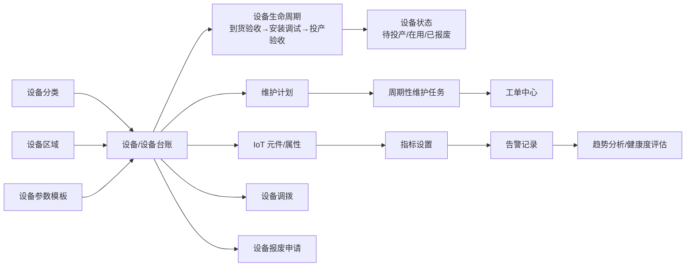
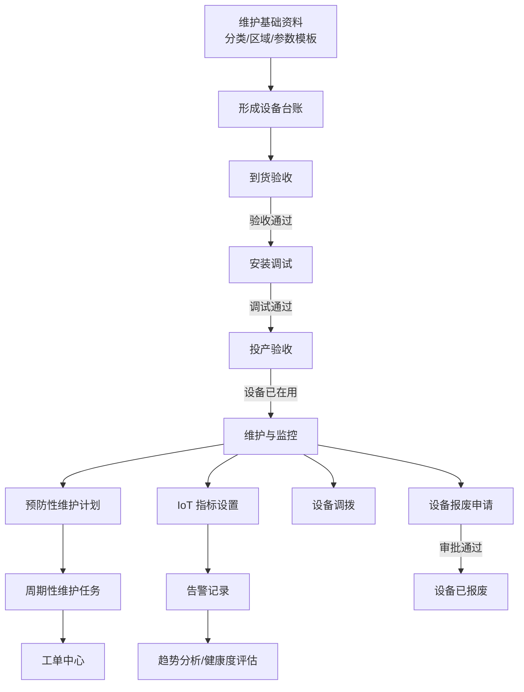

# 设备管理运维系统页面基线

## 1. 探索信息

- 探索时间：2026-11-10
- 本次运行标识：business-validation-20261110
- 验证数据前缀：`AUTO测试_勿用_20261110_`
- 测试环境：`http://192.168.6.163:66/`
- 目标应用：设备管理运维系统
- 范围来源：`禅道模块id.md`
- 范围模块：设备资产管理、基础信息维护、维护管理、工单管理及其子模块，共 25 个模块节点
- 探索方式：Playwright 可视浏览器，固定 `headless=False`；登录和门户仅用于进入目标应用，不纳入业务页面基线

## 2. 探索结论

已复用保存的认证态进入门户和目标应用：`/biopark-eam/index`。本次仅访问禅道模块范围内的一级、二级及三级页面，未进入“系统管理”等范围外模块。范围内 8 个二级页面和 13 个三级 Tab 均成功访问并采集结构证据；未执行新增、提交、更新、删除等写操作，因此无本次创建的数据需要清理。

目标应用首页标题为“设备管理运维系统 - 首页”，业务页面统一位于 `/biopark-eam` 下。页面通常采用左侧一级/二级菜单、内容区标题、筛选区、操作按钮和表格分页布局；页面常见操作包括查询、重置、刷新、表头设置、查看、编辑、删除及流程动作。

## 3. 范围内页面基线

### 3.1 设备资产管理

| 页面 | URL | 真实页面证据 |
|---|---|---|
| 设备生命周期管理 / 到货验收 | `/biopark-eam/eam/lifecycle` | 筛选“ID、物料名称、验收状态”；按钮“查询、重置、新增采购单、刷新、表头设置”；表格包含采购单号、物料名称、规格型号、明细数量、验收数量、验收状态、操作人、操作时间、操作；支持“发起验收、历史操作记录”。 |
| 设备生命周期管理 / 安装调试 | `/biopark-eam/eam/lifecycle` | 筛选“ID、调试状态”；表格包含 ID、设备编号、设备名称、调试状态、调试人员、调试日期、备注、操作；支持“发起调试、再次调试、历史操作记录”，已存在“调试通过、待调试、调试不通过”等状态。 |
| 设备生命周期管理 / 投产验收 | `/biopark-eam/eam/lifecycle` | 筛选“ID、验收状态”；按钮“手动补建、刷新、表头设置”；表格包含 ID、设备编号、设备名称、验收状态、验收人员、验收日期、备注、操作；支持“发起验收、历史操作记录、设备已在用”。 |
| 设备生命周期管理 / 设备调拨 | `/biopark-eam/eam/lifecycle` | 按钮“发起调拨、刷新、表头设置”；表格包含 ID、设备编号、设备名称、调出组织、调入组织、调拨日期、交接人、调拨原因、操作；支持“查看详情”。 |
| 设备生命周期管理 / 设备报废 | `/biopark-eam/eam/lifecycle` | 筛选“申请 ID、申请状态”；按钮“查询、重置、刷新、表头设置、发起报废申请”；表格包含申请 ID、设备名称、申请状态、操作人、报废日期、报废说明、操作；支持“查看申请”，状态可见“审批中、审批通过”。 |
| 设备台账管理 | `/biopark-eam/eam/ledger` | 筛选“设备编号、设备名称、归属组织、区域、当前状态”；按钮“查询、重置、刷新、表头设置”；表格包含设备编号、设备名称、规格型号、生产厂家、IoT 元件、归属组织、区域、当前状态、创建时间、操作；支持“查看详情”。 |

### 3.2 基础信息维护

| 页面 | URL | 真实页面证据 |
|---|---|---|
| 设备分类 | `/biopark-eam/eam/basic-info/categories` | 筛选“分类信息”；按钮“查询、重置、新增分类”；列表项展示编码和启用状态；每项支持“编辑、停用、删除”。 |
| 设备区域 | `/biopark-eam/eam/basic-info/areas` | 筛选“区域信息”；按钮“查询、重置、新增区域”；列表项展示编码和启用状态；每项支持“编辑、停用、删除”。 |
| 设备参数模板 | `/biopark-eam/eam/basic-info/parameter-templates` | 按钮“刷新、表头设置、新建参数模板”；表格包含模板名称、更新时间、操作；支持“查看参数项、删除”。 |

### 3.3 维护管理

| 页面 | URL | 真实页面证据 |
|---|---|---|
| 预防性维护 / 维护计划 | `/biopark-eam/eam/maintenance/preventive` | 筛选“计划名称、计划状态”；按钮“查询、重置、刷新、表头设置、新建维护计划”；表格包含计划名称、设备、工单类型、维护周期、开始日期、下次生成时间、负责人、计划状态、操作；支持“查看、停用”。 |
| 预防性维护 / 计划排程 | `/biopark-eam/eam/maintenance/preventive` | Tab 可访问；本次采集到同一维护管理容器下的页面状态和交互入口，具体运行时证据见 `tab-baseline.json`。 |
| 预防性维护 / 周期性维护任务 | `/biopark-eam/eam/maintenance/preventive` | Tab 可访问；本次采集到同一维护管理容器下的页面状态和交互入口，具体运行时证据见 `tab-baseline.json`。 |
| 预防性维护 / 维护模板 | `/biopark-eam/eam/maintenance/preventive` | Tab 可访问；本次采集到同一维护管理容器下的页面状态和交互入口，具体运行时证据见 `tab-baseline.json`。 |
| 预警性维护 / 指标设置 | `/biopark-eam/eam/maintenance/early-warning` | 筛选设备台账、IoT 元件、IoT 属性、状态；按钮“查询、重置、刷新、表头设置、新建指标配置”；表格包含设备台账、IoT 元件、IoT 属性、持续告警周期、上下限、状态、操作；支持“查看、编辑、删除”。 |
| 预警性维护 / 告警记录 | `/biopark-eam/eam/maintenance/early-warning` | Tab 可访问；本次采集到同一预警维护容器下的页面状态和交互入口，具体运行时证据见 `tab-baseline.json`。 |
| 预警性维护 / 趋势分析 | `/biopark-eam/eam/maintenance/early-warning` | Tab 可访问；本次采集到同一预警维护容器下的页面状态和交互入口，具体运行时证据见 `tab-baseline.json`。 |
| 预警性维护 / 健康度评估 | `/biopark-eam/eam/maintenance/early-warning` | Tab 可访问；本次采集到同一预警维护容器下的页面状态和交互入口，具体运行时证据见 `tab-baseline.json`。 |

### 3.4 工单管理

| 页面 | URL | 真实页面证据 |
|---|---|---|
| 工单中心 | `/biopark-eam/eam/work-orders/list` | 顶部展示全部工单、待派工、执行中、待验收、已关闭、完成率、MTBF、MTTR；筛选工单号、设备名称、工单类型、工单状态、创建人；按钮“查询、重置、导出当前页、新建工单、展开、刷新、表头设置”；表格包含工单号、工单类型、设备名称、优先级、工单状态、创建人、负责人、创建时间、操作；支持“查看、编辑、派工、历史记录”。 |

## 4. 页面通用交互基线

- 页面左侧菜单包含：首页、设备资产管理、基础信息维护、维护管理、工单管理；界面同时可见“系统管理”，但本次未点击或探索。
- 列表页普遍使用中文按钮文本和可见表格；多数列表支持分页，页面显示“20条/页”。
- 常见稳定定位依据：一级/二级菜单和三级 Tab 的精确可见文本；操作按钮的精确可见文本；业务页面 URL 路径。
- 本次未将已有业务数据视为本轮测试数据，也未修改已有数据；页面展示的历史测试数据仅作为只读基线记录。
- 三级 Tab 点击后 URL 保持二级容器路径，页面内容和操作区随 Tab 切换变化，应以页面标题及 Tab 文本共同判断当前页面。

## 5. 全量数据与状态按钮探索

本轮使用固定 `headless=False` 的可视 Playwright 浏览器，逐页点击“重置”清空筛选后重新查询；无“重置”按钮的参数模板页直接读取完整列表。未进入“系统管理”。证据：`07_ui_automation/reports/all-states-exploration.json` 及对应 `all-*.png`。

| 页面 | 全量结果/状态覆盖 | 页面上发现的操作按钮 |
|---|---|---|
| 设备生命周期管理 / 到货验收 | 5 条采购验收数据；覆盖待验收、部分验收、通过等状态 | 发起验收、历史操作记录；新增采购单、刷新、表头设置 |
| 设备台账管理 | 14 条台账；覆盖待投产、在用、已报废，包含有/无 IoT 关联 | 查看详情、刷新、表头设置；详情允许查看设备履历、维保历史、故障历史和保存入口（本轮未保存既有数据） |
| 设备分类 / 设备区域 | 分别读取 4 条、6 条；每行均显示启用、编辑、停用、删除 | 新增、查询、重置及行级编辑/停用/删除 |
| 设备参数模板 | 1 条模板 | 查看参数项、删除、刷新、表头设置、新建参数模板 |
| 预防性维护 / 维护计划 | 2 条启用计划 | 查看、停用、新建维护计划；计划排程显示当前范围暂无启用维护计划 |
| 预防性维护 / 周期性维护任务 | 2 条未完成、0 条执行中、0 条待验收；任务状态为待接受 | 查看工单、刷新、表头设置 |
| 预防性维护 / 维护模板 | 1 条模板 | 查看、编辑、删除、新建维护模板、刷新、表头设置 |
| 预警性维护 / 指标设置 | 2 条启用指标配置 | 查看、编辑、删除、新建指标配置、刷新、表头设置 |
| 预警性维护 / 告警记录 | 23 条告警，当前页 20 条；处理状态为待处理 | 查看、创建维护工单、查询、重置、刷新、表头设置 |
| 预警性维护 / 趋势分析 | 查询区域提示“请选择设备、元件和 IoT 属性后查询”；页面出现“服务器错误，请联系管理员” | 仅查询；本轮未伪造设备、元件和属性条件 |
| 预警性维护 / 健康度评估 | 14 条结果；同时看到健康、风险等级 | 查看、历史记录、调整健康度、查询、重置、刷新、表头设置 |
| 工单中心 | 1 条待派工工单；顶部统计卡片显示全部工单、待派工、执行中、待验收、已关闭 | 查看、编辑、派工、历史记录、新建工单、导出当前页、展开、刷新、表头设置 |

### 5.1 非破坏性按钮点击结果

本轮对全量数据中的查看类、历史记录类按钮执行了真实点击并关闭弹窗，未对既有对象保存修改：

- 到货验收“历史操作记录”：弹窗显示共 0 条。
- 设备台账“查看详情”：打开“编辑设备台账”详情，确认归属组织/区域不可直接修改，变更需走设备调拨；未点击保存。
- 参数模板“查看参数项”：打开参数项详情；未保存修改。
- 维护计划、维护模板、指标设置：均成功打开详情弹窗。
- 告警记录“查看”：成功打开告警详情，显示处理状态“待处理”和“未创建”维护工单。
- 健康度评估“查看”和“历史记录”：成功打开详情及健康度历史弹窗，确认系统计算记录和评分规则。
- 工单中心“查看”：成功打开工单详情；随后“历史记录”因详情弹窗遮挡未完成点击，未绕过遮挡强行操作。

### 5.2 既有数据写操作边界

虽然页面存在编辑、删除、停用、派工、创建维护工单、调整健康度等按钮，本轮没有对既有数据执行提交。根据本项目约束，这些按钮只有在本轮自建且可完整清理的数据上才允许提交；本轮没有新建设备台账、IoT 关联、告警记录或工单链路对象，因此不对既有业务对象执行破坏性操作。可点击的非破坏性查看按钮已单独记录。

## 6. 真实提交验证结果

验证批次：`AUTO测试_勿用_20261110_`、`AUTO测试_勿用_20261110B_`。所有写操作均限定在本轮自建对象；未编辑或删除既有数据。

| 模块 | 空提交校验 | 新增 | 编辑 | 状态流转 | 删除/回读 |
|---|---|---|---|---|---|
| 设备分类 | 通过：提示“请输入分类名称” | 通过；提示“设备分类保存成功”，列表可见对象 | 通过；改名为 `AUTO测试_勿用_20261110B_分类编辑` | 通过；停用提示“分类已停用”，行操作变为“启用”；再启用提示“分类已启用”，行恢复“停用” | 通过；刷新回读确认不存在 |
| 设备区域 | 通过：提示“请输入区域名称” | 通过；提示“设备区域保存成功”，列表可见对象 | 通过；改名为 `AUTO测试_勿用_20261110B_区域编辑` | 通过；停用提示“区域已停用”，行操作变为“启用”；再启用提示“区域已启用”，行恢复“停用” | 通过；刷新回读确认不存在 |
| 设备参数模板 | 通过：提示“请填写模板名称和完整参数名称” | 通过；保存提示“参数模板已保存”，列表可见对象 | 未执行 | 不适用 | 通过；删除确认后刷新回读确认不存在 |
| 预防性维护 / 维护计划 | 通过：提示“请输入计划名称、请选择设备、请选择工单类型、请选择周期单位、请选择开始日期、请选择负责人” | `dependency_blocked`：需要设备、工单类型、负责人和维护内容等前置数据，未借用既有数据 | 未执行 | 未执行 | 无对象 |
| 预警性维护 / 指标设置 | 通过：提示“请选择设备台账” | `dependency_blocked`：需要本轮可控且关联 IoT 元件的设备台账，未借用既有设备 | 未执行 | 未执行 | 无对象 |
| 工单中心 | 通过：提示“请完善设备、故障现象、故障发生时间和负责人” | `dependency_blocked`：需要设备台账和负责人，未借用既有数据 | 未执行 | 未执行 | 无对象 |

### 5.1 已验证交互

- 基础资料新增：点击“新增分类/新增区域”打开弹窗，空提交阻止保存；填入唯一前缀名称后保存成功并回到列表。
- 基础资料编辑：按本轮自建对象定位树行，编辑名称后保存成功，列表回读编辑后名称。
- 基础资料状态流转：停用后行状态和操作入口变为“启用”，再次启用后恢复“停用”；均有对应成功提示。
- 基础资料删除：点击目标树节点的“删除”，出现确认弹窗；确认后刷新列表并回读，结果不存在。
- 参数模板新增：填写模板名称、参数名称、单位、排序、说明和默认值后保存成功；删除确认后回读不存在。
- 维护计划、指标设置和工单中心均执行空提交，真实提示已记录，未产生对象；由于设备台账、IoT 和负责人等依赖未安全构造，本轮没有借用既有数据强行提交。
- 所有写操作均未触碰既有数据。

### 5.2 数据关系与依赖

已从表单实际字段确认的关系：维护计划要求设备、工单类型、负责人和维护内容；指标设置要求具有关联 IoT 元件和数值属性的设备台账；工单中心创建故障报修要求设备、故障现象、故障发生时间和负责人。设备分类、区域和参数模板属于设备台账的基础配置来源。生命周期页面通过验收、调试、投产验收推动设备状态，调拨和报废是设备后续生命周期动作。

### 5.3 业务流程图

流程图表示页面和字段关系基线；除设备分类、设备区域的新增/删除闭环及空提交校验外，依赖设备台账、IoT 或审批的数据流转本轮未提交验证。

## 6. 数据操作与清理

- 本轮创建对象：`AUTO测试_勿用_20261110B_分类`、`AUTO测试_勿用_20261110B_区域`、`AUTO测试_勿用_20261110B_参数模板`。
- 分类和区域：已完成新增、编辑、停用、启用、删除及刷新回读。
- 参数模板：已完成新增、删除及刷新回读；未执行编辑和状态流转（页面未提供对应操作）。
- 未创建：维护计划、指标配置、工单；空提交校验均阻止保存，且依赖对象未安全构造。
- 无待清理数据；没有对历史既有数据执行编辑、停用、删除或状态流转。
- 无法清理数据：无。

## 7. 证据

- 本轮基础对象首次验证摘要：`07_ui_automation/reports/crud-validation.json`
- 本轮编辑/启停/参数模板验证摘要：`07_ui_automation/reports/continue-validation.json`、`07_ui_automation/reports/template-validation.json`
- 本轮全量数据和状态按钮摘要：`07_ui_automation/reports/all-states-exploration.json`
- 本轮非破坏性按钮点击摘要：`07_ui_automation/reports/safe-action-results.json`
- 本轮依赖表单校验摘要：`07_ui_automation/reports/continue-dependent-validation.json`
- 设备分类/区域/参数模板表单截图：`07_ui_automation/reports/validation-inspect-category.png` 等
- CRUD 操作截图：`07_ui_automation/reports/crud-category-empty.png`、`crud-category-created.png`、`crud-category-deleted.png` 等
- 依赖表单空提交截图：`07_ui_automation/reports/dependent-plan-empty.png`、`dependent-metric-empty.png`、`dependent-workorder-empty.png`
- 门户进入截图：`07_ui_automation/reports/saved-auth-portal.png`
- 目标应用入口截图：`07_ui_automation/reports/saved-auth-app-entry.png`
- 首页截图：`07_ui_automation/reports/baseline-home.png`
- 二级模块摘要：`07_ui_automation/reports/module-baseline.json`
- 二级模块截图：`07_ui_automation/reports/01-设备资产管理-设备生命周期管理.png` 等
- 三级 Tab 摘要：`07_ui_automation/reports/tab-baseline.json`
- 三级 Tab 截图：`07_ui_automation/reports/tab-01.png` 至 `tab-13.png`
- 本轮一次性脚本已在清理阶段删除。

## 7. 未解决问题与后续建议

- 三级 Tab 的页面路径复用父级容器 URL；后续编写自动化时应使用 Tab 文本和页面内容作为断言，不仅依赖 URL。
- 全量状态探索发现既有数据中同时存在待投产、在用、已报废、待处理、健康、风险和待派工等状态；不同状态会改变行级操作按钮，不能只验证默认筛选结果。
- 工单中心当前全量查询仅显示 1 条待派工工单；执行中、待验收、已关闭没有可操作行，无法在不创建并污染依赖链的前提下验证对应状态按钮。
- 趋势分析继续出现服务端错误；本轮仅记录真实页面结果，未通过伪造筛选条件规避。

- 设备分类和设备区域已完成新增、编辑、停用、启用、删除及回读；参数模板已完成新增、删除及回读。
- 维护计划、指标配置、工单新增及生命周期状态流转仍未完成真实提交；主要原因是设备台账、IoT 元件/属性、负责人、维护内容及审批前置数据需要安全构造，不能借用既有数据。
- 趋势分析、健康度评估此前已发现服务端错误，且本轮未重复提交或访问范围外页面。
- “系统管理”等范围外模块未探索。
